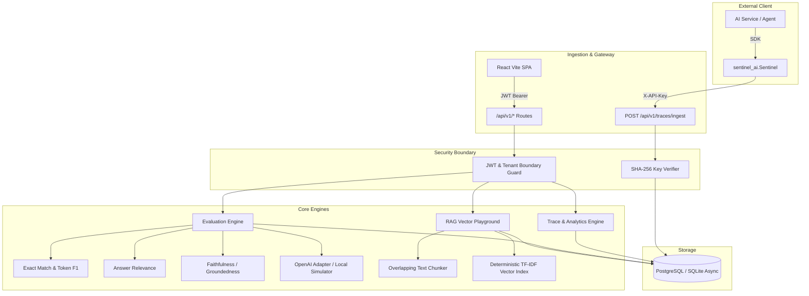

# Sentinel AI

<div align="center">

**Enterprise LLM Observability, Evaluation & Reliability Platform**

*Monitor. Evaluate. Trust your AI.*

[](https://github.com/your-org/sentinel-ai/actions)
[](LICENSE)
[](https://python.org)
[](https://fastapi.tiangolo.com)
[](https://react.dev)
[](https://www.typescriptlang.org)

</div>

---

## 1. Product Overview

**Sentinel AI** is a production-oriented developer platform engineered to monitor, evaluate, debug, and benchmark LLM-powered applications, AI agents, and RAG (Retrieval-Augmented Generation) pipelines.

Unlike dashboard mockups or toys with decorative hardcoded charts, Sentinel AI is an end-to-end full-stack software system backed by real database analytics, cryptographic key hashing, deterministic mathematical evaluations, and a zero-paid-API local execution mode.

---

## 2. Features

- **LLM Observability & Tracing**: Ingest traces, sub-spans, prompt payloads, model outputs, token consumption (input/output), duration, and estimated cost.
- **Percentile Latency & Cost Analytics**: Database-driven calculation of P95/P99 latency, error rates, model distribution, volume trends, and recent error diagnostics.
- **Evaluation Engine**: Run reproducible evaluations against curated datasets. Calculate Exact Match, Token F1, Answer Relevance, and Faithfulness.
- **Model & Prompt Comparison**: Side-by-side benchmark comparison showing score deltas, latency trade-offs, and classified per-example regressions vs improvements.
- **Interactive RAG Playground**: Upload documents, configure chunk size/overlap, query using local deterministic TF-IDF vector retrieval, and evaluate context faithfulness and query relevance.
- **Cryptographic Ingestion Keys**: Generate high-entropy API keys stored as SHA-256 hashes with one-time reveal modals and instant revocation.
- **Python Client SDK (`sentinel_ai`)**: Resilient, non-blocking Python client for seamless instrumentation of external AI services.
- **Zero Paid API Requirement**: Fully functional out of the box with zero external dependencies. External LLMs can be configured optionally via environment variables.

---

## 3. Screenshots

| Overview Dashboard | Trace Explorer & Waterfall Spans |
|:---:|:---:|
|  *Real-time telemetry, volume trends, and cost estimation* |  *Spans waterfall, latency breakdown, and payload inspection* |

| Evaluation Engine & Results | Side-by-Side Model Comparison |
|:---:|:---:|
|  *Per-example evaluation results and metric summaries* |  *Score deltas, regressions, and prompt output differences* |

| RAG Playground & Retrieval | Ingestion API Keys & Python SDK |
|:---:|:---:|
|  *Chunking, vector similarity, and faithfulness scoring* |  *SHA-256 hashed keys and pre-filled Python client snippet* |

---

## 4. Architecture Diagram



---

## 5. Technology Stack

- **Frontend**: React 19, TypeScript (Strict Mode), Vite, Tailwind CSS, Lucide Icons.
- **Backend**: Python 3.13, FastAPI, Pydantic v2, SQLAlchemy 2.x (Asyncio), Alembic.
- **Databases**: SQLite (Async driver `aiosqlite` for zero-setup local dev/test) / PostgreSQL 16+ (via `asyncpg` for production).
- **Client SDK**: `sentinel_ai` Python client with sync & async dispatch.
- **DevOps & Testing**: Docker, Docker Compose, Nginx, GitHub Actions CI, Pytest, Vitest.

---

## 6. Repository Structure

```
sentinel-ai/
├── backend/
│   ├── alembic/              # Database schema migrations
│   ├── app/
│   │   ├── api/v1/           # API endpoints (auth, traces, datasets, evals, rag, keys)
│   │   ├── core/             # Configuration, security, database session, dependencies
│   │   ├── models/           # SQLAlchemy 2.0 ORM models
│   │   ├── schemas/          # Pydantic v2 schemas
│   │   ├── services/         # Cost models, evaluation engine, RAG TF-IDF retriever
│   │   └── main.py           # FastAPI application entrypoint
│   └── requirements.txt      # Pinned backend dependencies
├── frontend/
│   ├── src/
│   │   ├── api/              # HTTP client wrapper
│   │   ├── components/       # Layout, StatCard, Badge, Modal dialogs
│   │   ├── context/          # Auth & Project context provider
│   │   ├── pages/            # Dashboard, Traces, Datasets, Evals, Compare, RAG, Keys, Settings, Login
│   │   └── index.css         # Enterprise dark theme styles
│   └── package.json
├── sdk/
│   ├── sentinel_ai/          # Python client SDK package
│   └── setup.py
├── docs/                     # Comprehensive architecture, API, security, and eval docs
├── tests/
│   └── backend/              # Pytest suite (auth, traces, datasets, evals, security, e2e)
├── infra/                    # Dockerfile.backend, Dockerfile.frontend, nginx.conf
├── docker-compose.yml        # Multi-container orchestration
├── .env.example              # Documented environment variables
└── README.md
```

---

## 7. Prerequisites

- **Python 3.11+** (Tested on Python 3.13)
- **Node.js 20+** (Tested on Node.js 22)
- **Git**
- Optional: **Docker** and **Docker Compose** for containerized deployments.

---

## 8. Quick-Start Instructions

### Option A: Local Bare-Metal (Recommended for immediate testing)

#### 1. Backend Setup
```bash
# Clone the repository
git clone https://github.com/your-org/sentinel-ai.git
cd sentinel-ai

# Create virtual environment
python -m venv venv

# Activate virtual environment
# Windows:
.\venv\Scripts\activate
# Linux/macOS:
source venv/bin/activate

# Install dependencies and SDK
pip install -r backend/requirements.txt
pip install -e sdk

# Apply database migrations
alembic upgrade head

# Start backend server
uvicorn backend.app.main:app --host 0.0.0.0 --port 8000 --reload
```

Backend will be active at `http://localhost:8000` (Swagger docs at `/api/docs`).

#### 2. Frontend Setup (in a separate terminal)
```bash
cd frontend
npm install
npm run dev
```

Open `http://localhost:5173` in your browser.  
Click **"⚡ Quick Demo Mode (Instant Evaluation)"** on the login screen to immediately explore the system!

---

### Option B: Docker Compose

```bash
cp .env.example .env
docker compose up -d --build
```
Access the application at `http://localhost:3000`.

---

## 9. Environment Variable Reference

| Variable | Default | Purpose |
|:---|:---|:---|
| `ENVIRONMENT` | `development` | Deployment environment (`development` / `production`) |
| `DATABASE_URL` | `sqlite+aiosqlite:///./sentinel.db` | Async SQLAlchemy database connection URL |
| `SECRET_KEY` | `sentinel-super-secret-...` | Cryptographic secret for signing JWT sessions |
| `ALGORITHM` | `HS256` | JWT signature algorithm |
| `ACCESS_TOKEN_EXPIRE_MINUTES` | `10080` | Session validity duration (7 days) |
| `OPENAI_API_KEY` | `""` | Optional external OpenAI key for model-as-a-judge |
| `OPENAI_BASE_URL` | `https://api.openai.com/v1` | Custom or proxy endpoint for external LLMs |

---

## 10. Database Setup & Migrations

Sentinel AI uses Alembic for declarative database versioning.

```bash
# Run latest database migrations
alembic upgrade head

# Create a new migration revision
alembic revision --autogenerate -m "Add custom index"

# Rollback one migration
alembic downgrade -1
```

---

## 11. How to Run Tests

### Run Backend Tests (Pytest)
```bash
pytest -v tests/backend
```
Executes all unit, integration, multi-tenant isolation, and complete 11-step E2E workflow tests.

### Run Frontend Tests (Vitest)
```bash
cd frontend
npm test
```

### Production Frontend Build Check
```bash
cd frontend
npm run build
```

---

## 12. Example SDK Integration

```python
from sentinel_ai import Sentinel

# Initialize Sentinel Client
client = Sentinel(
    base_url="http://localhost:8000",
    api_key="sentinel_YOUR_PROJECT_API_KEY",
    project_id="YOUR_PROJECT_ID",
    async_dispatch=True,  # Non-blocking background dispatch
)

# Instrument LLM request execution
client.log_event(
    model="gpt-4o",
    operation="generation",
    input_tokens=150,
    output_tokens=80,
    latency_ms=320.5,
    status="success",
    input_payload="What is the refund window?",
    output_payload="Annual plans are eligible for refund within 30 days.",
    metadata={"user_tier": "enterprise"},
)
```

---

## 13. API Documentation Overview

- `POST /api/v1/auth/register` — Register account and bootstrap workspace.
- `POST /api/v1/auth/demo-login` — Zero-setup instant demo evaluation.
- `POST /api/v1/traces/ingest` — High-throughput trace & span ingestion.
- `GET  /api/v1/projects/{project_id}/dashboard` — Real database analytics and latency percentiles.
- `POST /api/v1/projects/{project_id}/evaluations` — Execute evaluation benchmark against dataset.
- `GET  /api/v1/projects/{project_id}/evaluations/compare/{b_id}/{c_id}` — Regression and delta analysis.
- `POST /api/v1/projects/{project_id}/rag/collections/{col_id}/query` — Vector retrieval and faithfulness scoring.

Full API documentation available in [`docs/api.md`](docs/api.md).

---

## 14. Evaluation Methodology & Metric Limitations

Detailed in [`docs/evaluation-methodology.md`](docs/evaluation-methodology.md):
- **Exact Match**: Binary normalized string comparison. Discloses strictness on generative paraphrasing.
- **Token F1**: Multiset precision, recall, and harmonic mean on normalized word tokens.
- **Answer Relevance**: Measured via query keyword density and token coverage.
- **Faithfulness**: Proportion of generated answer claims grounded directly in retrieved context.
- **Local Fallback**: Deterministic local simulation engine enables complete testing without external API billing.

---

## 15. Security Considerations

Detailed in [`docs/security.md`](docs/security.md):
- Ingestion API keys are salted and hashed with **SHA-256**; raw keys are revealed only once.
- Cross-workspace isolation tests verify that no tenant can inspect another workspace's traces or keys.
- SQL injection is eliminated via parameterized SQLAlchemy 2.0 ORM operations.
- Secret environment variables are never exposed via health or operational diagnostics endpoints.

---

## 16. Deployment Instructions

Detailed in [`docs/deployment.md`](docs/deployment.md):
- Complete production readiness checklist.
- Docker Compose multi-container setup with Postgres and Nginx.
- Production reverse-proxy configuration.

---

## 17. Known Limitations

- **Semantic Embedding Fallback**: In local zero-paid-API mode, RAG retrieval uses deterministic TF-IDF with cosine similarity rather than dense transformer embeddings. Real dense embeddings are supported when provider credentials are configured.
- **Cost Estimates**: Token cost calculations use published pricing models and are explicitly designated as *estimated* rather than provider invoice-reported costs.

---

## 18. Roadmap

- [ ] Automated scheduled evaluation runs via background crons.
- [ ] Export evaluation reports to PDF/CSV.
- [ ] OpenTelemetry (OTEL) direct collector ingestion receiver.
- [ ] Integration with LangChain and LlamaIndex callback handlers.

---

## 19. Contribution Instructions

1. Fork the repository.
2. Create a feature branch: `git checkout -b feature/awesome-feature`
3. Commit your changes: `git commit -m 'feat: add awesome feature'`
4. Run all test suites: `pytest -v tests/backend && cd frontend && npm test`
5. Push to the branch: `git push origin feature/awesome-feature`
6. Open a Pull Request.

---

## 20. License

Sentinel AI is open-sourced under the [Apache License 2.0](LICENSE).
