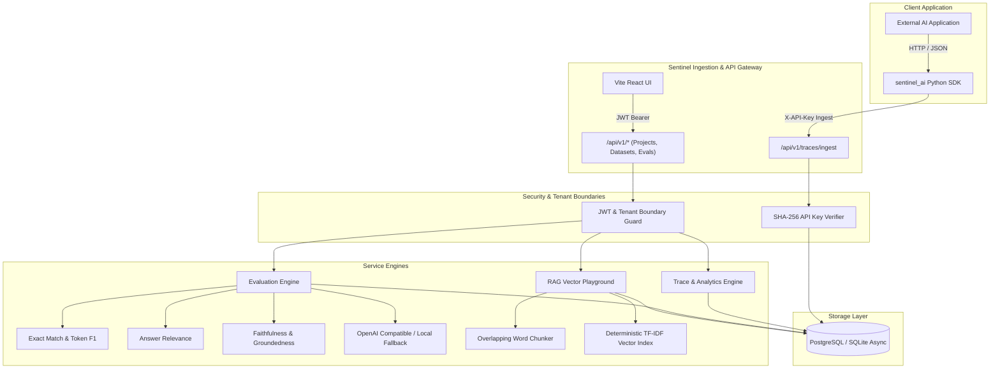

# Sentinel AI System Architecture

## Overview
Sentinel AI is an enterprise-grade LLM Observability, Evaluation, and Reliability platform. The platform is architected around a high-throughput trace ingestion pipeline, an isolated multi-tenant data model, a deterministic evaluation engine, and a vector-grounded RAG playground.

## Architectural Modules

### 1. Ingestion Pipeline
- **Endpoint**: `/api/v1/traces/ingest`
- **Authentication**: High-entropy API key passed via `X-API-Key` or `Authorization: Bearer sentinel_...`.
- **Payload Validation**: Strict Pydantic models validate model identifiers, operation categories, token counts, execution latency, metadata JSON, and child span trees.
- **Cost Estimation**: Calculates dollar expenditure per request based on published token rates for models (GPT-4o, Claude 3.5 Sonnet, Llama-3, etc.) while cleanly separating estimated cost from provider-reported invoices.

### 2. Evaluation Engine
- **Deterministic Metrics**:
  - **Exact Match**: Normalized, case-insensitive string equality.
  - **Token Precision, Recall, F1**: Multiset token intersection.
  - **Answer Relevance**: Documented query keyword density and token coverage ratio.
  - **Faithfulness / Groundedness**: Ratio of generated claim tokens directly grounded in retrieved context sentences.
  - **Context Precision & Recall**: Retrieval signal-to-noise ratio and ground-truth capture rate.
- **Provider Abstraction**:
  - Automatically switches between external LLM providers (when `OPENAI_API_KEY` is supplied) and deterministic local simulation fallback (guaranteeing zero paid external API requirements).

### 3. RAG Knowledge Playground
- **Document Chunking**: Configurable sliding window tokenizer preserving word boundaries with user-specified `chunk_size` and `chunk_overlap`.
- **Retrieval Engine**: Deterministic TF-IDF Vector Retriever with L2-normalized cosine similarity scoring. Runs locally without requiring heavyweight binary C extensions or external paid embedding services.
- **Scoring**: Computes real-time Answer Faithfulness and Query Relevance for every test query.

### 4. Multi-Tenant Security & Isolation
- Every database query strictly filters by `workspace.owner_id == current_user.id` or `api_key.project_id == project.id`.
- Foreign key cascading deletes clean up child datasets, examples, runs, results, and chunks when a parent entity is deleted.
